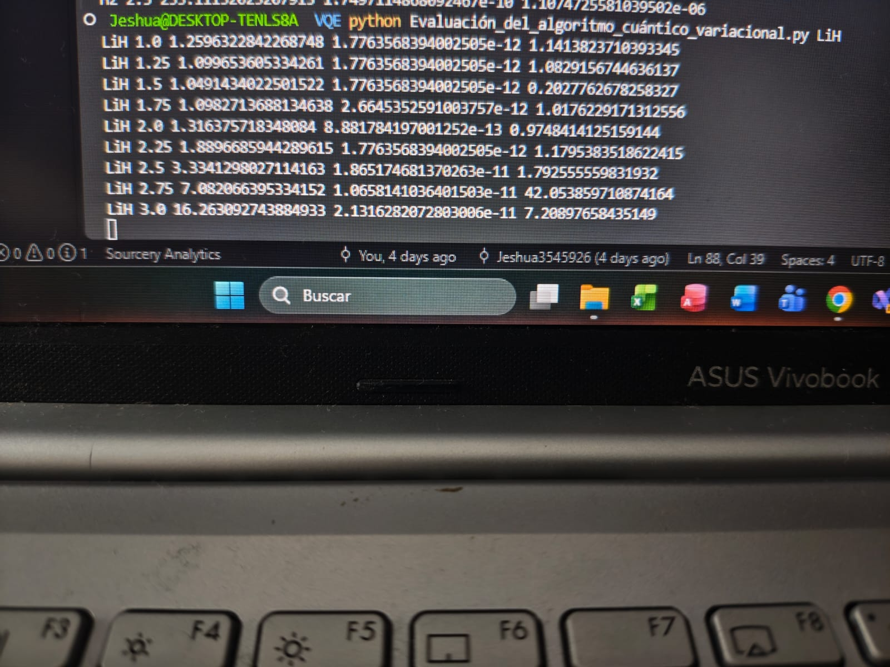
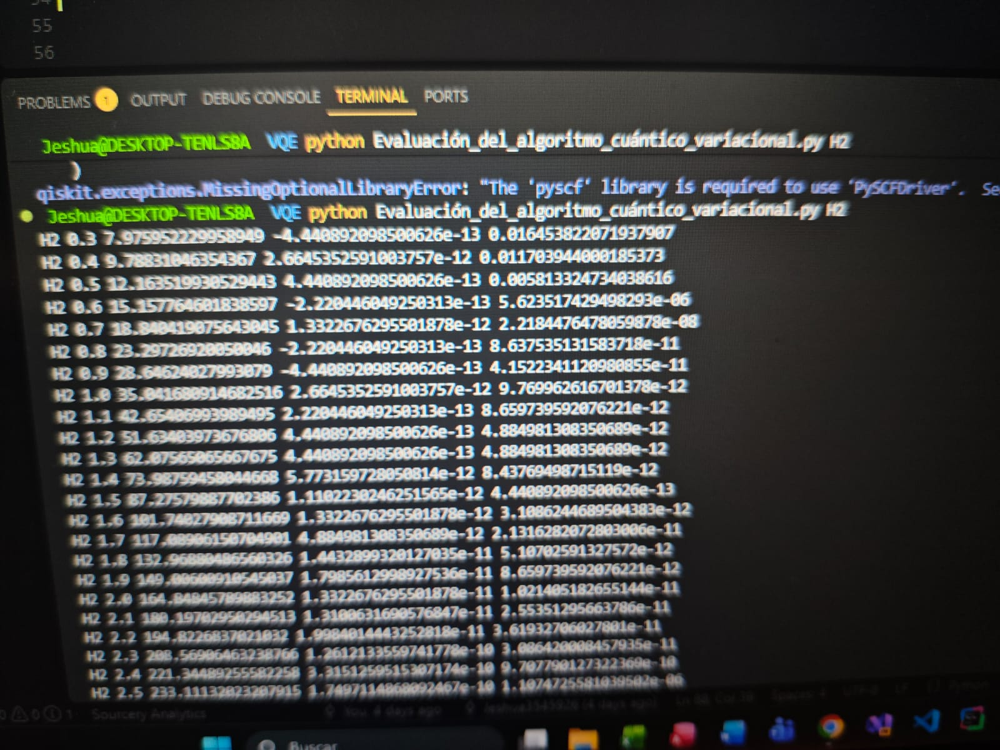
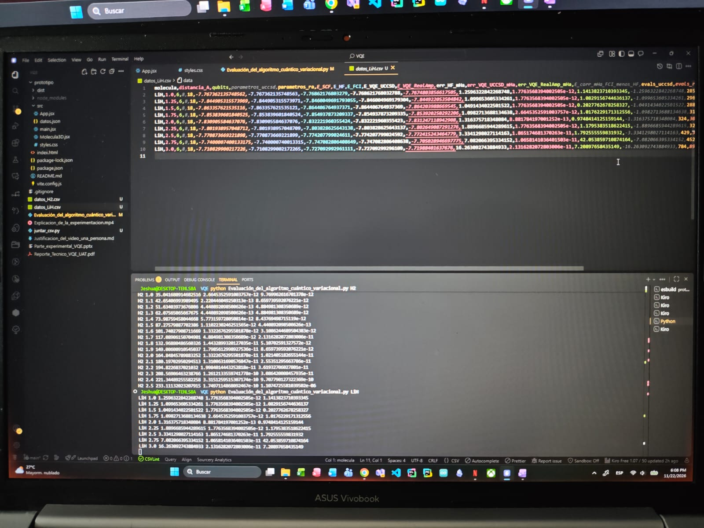

# Evidencia Fotográfica — Ejecución del VQE

---

## Evidencia 1 — Ejecución del script para LiH

Terminal mostrando la ejecución del script `Evaluación_del_algoritmo_cuántico_variacional.py` con la molécula LiH. Se observan los resultados por distancia internuclear: error de Hartree-Fock (mHa), error de VQE-UCCSD (mHa) y error de VQE-RealAmplitudes (mHa). La ejecución se realizó en una laptop ASUS Vivobook con VS Code.

---

## Evidencia 2 — Ejecución del script para H2 tras corregir dependencia

Terminal de VS Code mostrando dos ejecuciones consecutivas del script con H2. La primera falla con `MissingOptionalLibraryError` por la ausencia de `pyscf`. La segunda, luego de instalar la dependencia, completa exitosamente las 23 distancias internucleares e imprime los errores energéticos de cada método en miliHartrees.

---

## Evidencia 3 — Generación del CSV y estructura del proyecto

Vista del editor VS Code con el archivo `datos_LiH.csv` abierto mostrando los resultados tabulados de la molécula LiH. En la terminal inferior se ven las dos ejecuciones del script (H2 y LiH) completadas. El panel izquierdo muestra la estructura completa del proyecto incluyendo el script principal, los CSVs generados, el reporte y la presentación.

---
